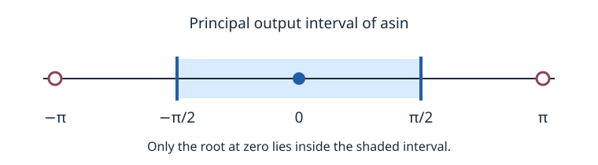

# 4. Inverse and derived functions

A function's defining relation can be useful even when you do not use a
dedicated constructor. For inverse functions, the relation must select the
intended branch. For derived functions, the component expressions must
preserve the intended domain.

Prerequisites: [exponentials and logarithms](exponential-logarithms.md)
and [trigonometric constraints](trigonometry.md).

## Choose an inverse branch

The relation `sin(y) = x` alone does not define the usual inverse sine.
It allows every angle whose sine equals `x`. The conventional real
principal branches can be described as follows:

| Function | Defining relation | Input domain | Principal output interval |
|---|---|---|---|
| `asin(x)` | `sin(y) = x` | `-1 <= x <= 1` | `-π/2 <= y <= π/2` |
| `acos(x)` | `cos(y) = x` | `-1 <= x <= 1` | `0 <= y <= π` |
| `atan(x)` | `tan(y) = x` | All real `x` | `-π/2 < y < π/2` |

These are mathematical encodings of the principal real functions. They
also explain what you must preserve when replacing a native inverse
operator with a relation. The generated operator table in
[expressions](expressions.md#operator-names) lists the native constructors;
their availability does not guarantee a decimal-valued model or a decided
query for every input.

<figure markdown="1">

<figcaption>The branch interval selects zero from the displayed roots of sin(y) = 0.</figcaption>
</figure>

<!-- example: docs/examples/inverse_branches.mojo -->

The first query permits `angle = π` as a root of `sin(angle) = 0`.
That does not make π the principal value of `asin(0)`. The second query
adds the principal interval and rules that candidate out.

The example establishes the branch restriction's effect on this candidate.
It does not claim that a solver will efficiently enumerate all roots or
eliminate every inverse operator in a general formula.

## Build hyperbolic functions

The real hyperbolic functions can be expressed with exponentials:

```math
\begin{aligned}
\sinh x &= \frac{e^x-e^{-x}}{2}, \\
\cosh x &= \frac{e^x+e^{-x}}{2}, \\
\tanh x &= \frac{\sinh x}{\cosh x}.
\end{aligned}
```

The denominator of the last expression is positive on the real domain.
The program below builds the first two expressions and checks their values
at zero by ruling out a violation of either identity.

<!-- example: docs/examples/hyperbolic.mojo -->

Because `exp(0) = 1`, substitution gives `sinh(0) = 0` and `cosh(0) = 1`.
The `unsat` result confirms those specific equalities. A universal identity
involving products of hyperbolic terms may require much more work; this
simple example is not evidence that every such identity will be decided.

## Positive-base real powers

For a positive real base `b` and real exponent `r`, use the identity
`b^r = exp(r*ln(b))`. A relational encoding introduces `base_log`:

```text
b > 0
exp(base_log) = b
value = exp(r * base_log)
```

The positivity assumption is essential for this real logarithm encoding.
It excludes zero and negative bases. Integer powers of a negative number
are perfectly meaningful, but require a different formulation. Do not
apply this transformation to those cases or silently extend it to complex
branches.

For a small fixed nonnegative integer exponent, a product of terms often
expresses the intended polynomial directly. For square roots of a
nonnegative real input, the algebraic relation `y*y = x` with `y >= 0`
selects the nonnegative root. Square root is algebraic even though it is
often discussed alongside the transcendental operators.

## Exercise: why the sign condition matters

Does `y*y = 4` define the square root of four?

**Worked answer.** It allows both two and negative two. Adding `y >= 0`
selects the conventional square root. This is the same modeling issue as
selecting the principal interval for inverse sine: a relation can admit
more values than the intended function.

Next: [proving bounds](bounds.md).
